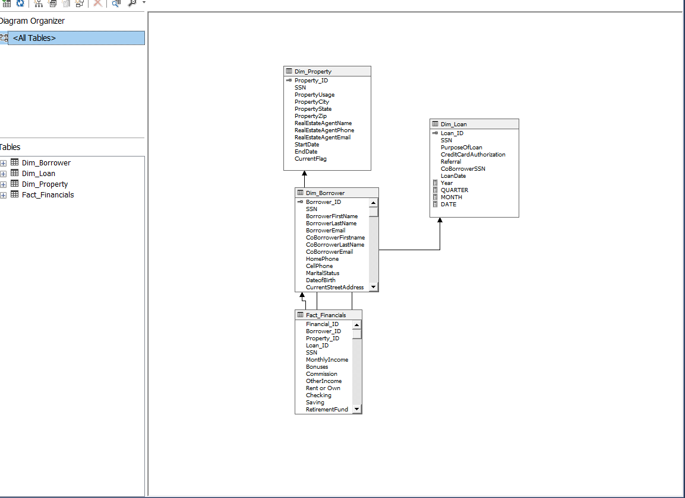
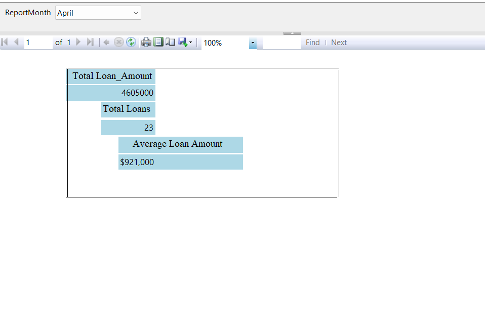
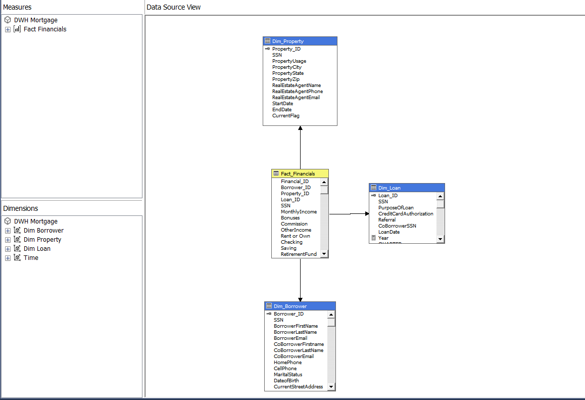

# Mortgage Data Warehouse & Business Intelligence
End-to-end mortgage data warehouse and business intelligence project using SQL Server, SSIS, dimensional modeling, SSRS, and SSAS.
## 📌 Project Overview
This project demonstrates the design and implementation of a data-driven mortgage reporting and business intelligence solution for a mortgage loan application process.
The project integrates data from multiple sources, applies ETL and data transformation processes, organizes the information into a dimensional data model, and provides reporting and analytical capabilities for business users.

## 🎯 Business Objective

The goal of this project is to:

- Support a data-driven mortgage loan application process

- Integrate data from multiple source systems

- Validate, clean, and transform source data

- Load processed data into an operational data store

- Build a dimensional data warehouse model

- Develop reporting and analytical solutions

- Provide business users with reliable information for decision-making

## 🏦 Project Scope

- The solution covers the major stages of the mortgage business intelligence process:

- Source Data → ETL → Operational Data Store → Dimensional Model → SSAS → SSRS Reporting

## 📥 Data Sources

The project worked with multiple source formats, including:

- Excel

- SQL Server

- XML

- The source data was prepared and integrated through ETL processes before being used for reporting and analytics.

## 🔄 ETL & Data Integration

SSIS was used to develop ETL workflows for extracting, transforming, validating, and loading mortgage-related data.

Key activities included:

- Source data extraction

- Data validation

- Data cleaning and transformation

- Lookup and data matching

- Conditional data processing

- Loading data into the operational data store

- Preparing data for the reporting warehouse

## 🗄️ Data Warehouse & Dimensional Modeling

A dimensional model was developed to organize mortgage information for reporting and analysis.

Key dimensional structures included:

- Dim_Borrower

- Dim_Property

- Dim_Loan

- Fact_Financials

- The dimensional model was designed to support business reporting and analytical queries.

## 🧮 SQL & Stored Procedures

SQL Server was used for data preparation, transformation, querying, and business logic.

Project work included:

- T-SQL queries

- Stored procedures

- Data validation

- Business-rule processing

- Relational data modeling

- Reporting queries

## 📊 SSRS Reporting

SQL Server Reporting Services (SSRS) was used to create reporting solutions for mortgage business users.

Reporting work included:

- Interactive reports

- Dashboard-style reporting

- Parameters and filtering

- Subreports

- Business-focused report layouts

## 📈 SSAS Analytics

- SQL Server Analysis Services (SSAS) was used to support analytical reporting and multidimensional business analysis.

- The analytical model connected mortgage dimensions and financial measures to support business reporting and exploration.
The cube includes financial measures and dimensions such as Borrower, Property, Loan, and Time.

 
## 🛠️ Technologies

- Database & SQL

- SQL Server

- SSMS

- T-SQL

- Stored Procedures

- ETL & Data Integration

- SSIS

- ETL

- Data Validation

- Data Transformation

- Business Intelligence

- SSRS

- SSAS

- Dimensional Modeling

- Data Warehousing

- Source Technologies

- Excel

- XML

- SQL Server

## 🔁 Project Workflow

- Collect source data

- Validate source information

- Extract and transform data using SSIS

- Load data into the operational data store

- Build the dimensional warehouse model

- Develop analytical structures using SSAS

- Create reports using SSRS

- Present business-ready information for decision-making

## 💡 Business Value

- This solution demonstrates how raw mortgage data can be transformed into a structured business intelligence environment.

- The resulting architecture supports:

- Consistent reporting

- Improved data organization

- Faster analytical access

- Reusable business logic

- Data-driven mortgage reporting

- Better visibility into loan and financial information

## 📁 Project Files

Project documentation, SQL scripts, ETL materials, reporting assets, and supporting screenshots will be added to this repository as the portfolio is developed.

👩‍💻 Author

Saba Gebremichael

 Data Analyst | Power BI | SQL | Business Intelligence

📧 seiona1212@gmail.com

🔗 GitHub: https://github.com/SabaGebremichael

This project was developed as part of my data analytics and business intelligence training and portfolio development.
